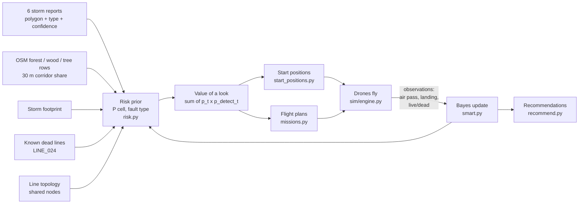

# How Storm Patrol works

This document explains the approach that the code actually implements and answers the four questions in [TASK.md](TASK.md). All numbers are taken from the code. File references are `path:line`. Every assumed value is listed in [ASSUMPTIONS.md](ASSUMPTIONS.md). This file explains how those values fit together; it does not repeat them all.

Where the planning docs ([PLAN.md](PLAN.md), [README.md](README.md), [ASSUMPTIONS.md](ASSUMPTIONS.md)) disagree with the code, the code wins. Those cases are listed in [Doc/code mismatches](#doc--code-mismatches).

## The idea in one picture

One number drives every decision: the **expected number of fault detections** a look at a line cell would produce. The planner keeps a probability per (cell, fault type) and turns it into that number using the published sensor detection rates. The same number picks the start positions, the flight routes, the landing spots and the short hops while charging.



The grid (64 lines, about 198 km) is cut into **418 cells** of about 500 m each (`backend/app/data.py:44`, `CELL_LENGTH_M` at `data.py:17`). Each line gets `n = max(1, round(length / 500 m))` equal pieces, with ids such as `LINE_035#23`. Risk, inspection state and findings are all tracked per cell.

The planner (`backend/app/planner/`) never imports the simulator (`backend/app/sim/`). It only sees the operator inputs, the published sensor and drone specs, and the observations the drones report. Real drones could send the same observations.

---

## 1. What would you measure?

We focus on **wind-storm damage**: vegetation on or near the line, galloping (wind-driven conductor motion), and the damage that follows from these, namely broken conductors, sag and hot joints. The model knows six fault types (`backend/app/models.py:16`): `vegetation`, `sag`, `ice`, `galloping`, `hotspot` and `broken_conductor`.

| Fault type | Sensor (from `backend/scenarios/demo.json`) | From the air (p_detect) | Landed (p_detect) |
|---|---|---|---|
| vegetation | RGB camera | 0.85 | 0.6 |
| broken_conductor | RGB camera | 0.8 | 0.7 |
| sag | RGB camera (air) / IMU inclinometer (landed) | 0.3 | 0.9 |
| ice | RGB camera / ice load cell (landed) | 0.5 | 0.9 |
| galloping | accelerometer, **landed only** | 0.0 | 0.85 |
| hotspot | **thermal camera (proposed extra)** / conductor temperature (landed) | 0.75 | 0.9 |

The false-positive rate is 0.1 % per cell pass and fault type in the demo, and 0.2 to 0.5 % in `default.json`.

The design splits sensors into two groups:

- **Air sensors** (camera, thermal camera) look at every cell the drone flies *along* (`backend/app/sim/engine.py:204`). They see nothing during straight cross-country transit.
- **Landed sensors** (current, inclinometer, accelerometer, conductor temperature) measure only the span the drone sits on. That is the only way to see galloping, and the best way to see sag and hot joints. A landing therefore has value of its own, and the planner treats it that way.

**Live or dead line.** When a drone lands, the current sensor tells the truth: zero current means the line is dead and the drone cannot charge. We also propose a **50 Hz magnetometer** that gives one live/dead reading per line per flight from the air, correct with p = 0.9 (`backend/app/sim/sensors.py:15`). This is not a Nomad feature; PLAN.md §4.4 gives the reasoning.

**What the readings can tell:** whether a cell probably has a fault of a given type, how confident the sensor is (true detections report 0.6 to 0.95 from the air and 0.85 to 0.99 when landed, `backend/app/sim/sensors.py:28`), and whether a line carries current.

**What they cannot tell:**

- A single pass misses faults. With p_detect_air = 0.85, one vegetation fault in seven goes unseen.
- Galloping is invisible from the air.
- A dead line's fault may not be on that line. It could be upstream, at a substation, or in the protection system. The data has no power-flow model.
- The magnetometer cannot tell which circuit of a double-circuit tower is live.
- Sensor confidence is not ground truth. False positives report 0.3 to 0.7.

The sensor model is a per-cell probability, not real imagery.

---

## 2. Where would you look first?

### 2.1 The risk map (prior)

For every cell *c* and fault type *t*, `prior()` (`backend/app/planner/risk.py:109`) computes a probability `p[c,t]`. Independent contributions are combined as `1 − Π(1 − p_i)` (`risk.py:31`), and the cell's overall risk is `1 − Π_t(1 − p[c,t])`. The five inputs are:

**a) Storm reports** (`risk.py:95`). Each of the six reports is a polygon, a list of fault types and a confidence:

- The fault types come from the report's `information_type` (`backend/app/data.py:20`). For example, `conductor_motion_report` maps to galloping and sag.
- The confidence comes from the report text: low 0.2, low to medium 0.35, medium 0.5, medium to high 0.65, high 0.8 (`data.py:31`). Reports 01 and 03 say "high that an event happened, low for its location", so they get 0.2 (`data.py:35`).

The report's contribution to every cell touching the polygon is:

```
p = confidence × w(type) × min(1, 10 / n_cells_in_polygon)
w = vegetation 1.0, galloping 1.0, hotspot 0.9, sag 0.7, broken_conductor 0.6, ice 0.5    (risk.py:17)
```

The `min(1, 10/n)` factor (`N_REF = 10`, `risk.py:19`) spreads the same evidence more thinly over a large, vague polygon. With the default inputs this gives:

| Report | cells | per-cell contribution |
|---|---|---|
| 01 weather alert (whole region) | 418 | ≈ 0.005 vegetation/galloping, 0.003 broken conductor |
| 02 vegetation & access | 22 | 0.16 vegetation |
| 03 protection event | 39 | 0.05 vegetation, 0.03 broken conductor |
| 04 orange flash | 8 | 0.32 hotspot, 0.21 broken conductor |
| 05 ticking & warmth | 56 | 0.06 hotspot |
| 06 conductor motion | 36 | 0.06 galloping, 0.04 sag |

**b) Vegetation layer** (`risk.py:71`). This is a one-off OpenStreetMap export of forest, wood and tree rows (`resources/external/vegetation.geojson`). For each cell we compute the share of its **30 m corridor** covered by those polygons, and set `p(vegetation) += 0.6 × share` (`W_VEG`, `risk.py:20`). A cell fully inside forest therefore starts at 0.6 vegetation risk with no report at all. This input is what finds faults that no report mentions.

**c) Background rate** (`risk.py:22`). After a storm, every cell gets a small base rate: 0.4 % for vegetation and broken conductor, 0.2 % for sag and hotspot, 0.1 % for galloping, and 0 for ice.

**d) Storm footprint** (`risk.py:24`). The background and forest terms of the wind-driven types (vegetation, galloping, broken conductor, sag) are multiplied by 1.0 if the cell midpoint lies inside the synthetic storm polygon, and by 0.4 outside it. 316 of the 418 cells are inside. Reports and operator knowledge are direct observations, so the footprint does not damp them (`risk.py:124`).

**e) Dead lines and topology** (`risk.py:128`, `backend/app/planner/smart.py:79`):

- A known dead line (the operator pre-fills LINE_024 from report 03) gets `p_live = 0`. It is never used for landing or charging. Its broken-conductor probability rises by `max(0.02, 0.3 / n_cells_of_line)`, because the fault that tripped it is probably somewhere on it.
- Lines that share a node with a dead line get +0.03 broken conductor and `p_live ≤ 0.8`. The bump is small because sharing a node does not prove an electrical connection.
- Every line touching the report 03 polygon (a "protection event") gets `p_live = 0.8`, since some line there may have tripped (`smart.py:85`). Every other line starts at `p_live = 0.9`.

**What is *not* used:** line voltage, circuits, line age, terrain and elevation are all ignored. Only geometry and the from/to node topology are read from the line attributes. Voltage and DEM were stretch goals in PLAN.md §4.2.

**Result on the default inputs:** cell risk runs from 0.02 to 0.62, with a median of 0.05. The top cells are LINE_024#14 and #15 (0.62: 100 % forest, inside the storm, on the dead line), LINE_035#23 (0.61: 100 % forest, no report) and LINE_037#03 to #05 (0.53 to 0.60: the small report 04 polygon plus forest).

### 2.2 From risk to value

`_values()` (`smart.py:180`) turns the belief into the expected number of detections:

```
air value(c)   = Σ_t p[c,t] · p_detect_air[t]
land value(c)  = Σ_t p[c,t] · p_detect_landed[t]
land_after(c)  = land value after a fruitless air pass   (what only landed sensors can still add)
```

A fault type with `p ≥ 0.8` counts as 0 unless it was detected but not yet confirmed, because we already know enough there (`smart.py:182`). Galloping has `p_detect_air = 0`, so it adds nothing to air value. All of its value sits in `land_after`. That is what pulls drones to *land* in the report 06 area rather than fly over it.

### 2.3 Picking the five positions

`SmartPlanner.start_positions()` (`smart.py:196`) calls `start_positions.choose()` (`backend/app/planner/start_positions.py:20`). It is a greedy loop over the five drones, and every candidate is judged by the real first flight that would start from it.

1. **Eligible cells.** A start cell must be on a line that is not dead, with `p_live ≥ 0.85` (`P_LIVE_START`, `start_positions.py:16`). The drones start docked and fully charged, but they must be able to charge there later. This rules out LINE_024, its node neighbours and the report 03 sector (all at 0.8).
2. **Spreading.** Each new drone must sit at least **3 km** from every earlier start cell (`MIN_SEPARATION_M`) and on a **different line** (`start_positions.py:33`). If no cell is left, the constraint is dropped (`start_positions.py:34`).
3. **Cheap ranking.** A proxy score is computed per cell (`start_positions.py:37`):
   - `kernel @ air_value`: the air value within reach, weighted linearly down to 0 at `budget × v_transit / 3` ≈ 7 km.
   - plus `3 × station value`. The *station value* (`backend/app/planner/missions.py:177`) is the landed-only value of the 6 best cells within 3 km. A drone charging there can check those cells with short take-off and land hops during its 3 h charge.
4. **Exact evaluation.** For the 40 best candidates (`N_EXACT`), the real flight planner (§3.2) plans the first flight. The candidate is scored as `flight value + 3 × station value at its landing cell` (`start_positions.py:45`). The best one wins.
   - The weight 3 (`W_STATION`, `start_positions.py:17`) is what stations a drone in the galloping area. With weight 1 no drone went there; weights 2 to 4 gave the same result (ASSUMPTIONS.md).
5. **Overlap penalty.** Cells covered by the chosen drone's first flight keep only **15 %** of their value for later drones (`OVERLAP`, `start_positions.py:52`), and so does the station value around its landing (`start_positions.py:55`).
6. **One drone per landing line.** The whole landing line is removed from the other drones' landing options (`start_positions.py:54`). If that line turns out dead, only one drone has to hop.

The first flights are then flown exactly as planned (`smart.py:226`, `first_plans`). Each position comes with a human-readable `reason` that the UI shows on hover.

### 2.4 The resulting placement (demo scenario, default operator inputs)

These positions come from running `SmartPlanner.start_positions()` on the default inputs. The placement does not depend on the hidden ground truth, so `default.json` gives the same five positions.

| Drone | Start line (cell) | Why (planner `reason`, abridged) | First flight inspects | Lands on |
|---|---|---|---|---|
| D1 | **LINE_037** (`#03`) | covers report 04 area + 2.8 km forest, 8 km line | LINE_037, LINE_033, LINE_034, LINE_038, LINE_059 | LINE_037#00 |
| D2 | **LINE_025** (`#00`) | covers reports 03 + 02 + 0.9 km forest, 12 km line | LINE_026, LINE_015 | LINE_015#17 |
| D3 | **LINE_004** (`#01`) | covers report 05 area + 2.2 km forest, 10 km line | LINE_024 (known dead, forest) | LINE_026#10 |
| D4 | **LINE_035** (`#22`) | covers report 02 area + 1.0 km forest, 12 km line | LINE_035, LINE_064 | LINE_025#00 |
| D5 | **LINE_060** (`#00`) | covers report 06 area + 0.6 km forest, 12 km line | LINE_054, LINE_003, LINE_056 | LINE_054#12 (galloping station) |

Each first flight takes about 21 to 22 minutes, which is the 22-minute budget described in §3.1. Note two things:

- D3 *starts* on LINE_004 but spends its whole first flight inspecting LINE_024. A dead line is still worth inspecting; the drone just cannot charge on it.
- D2 lands on LINE_015 with `p_live = 0.8`. That is fine for landing (threshold 0.6) but not for starting (threshold 0.85).

---

## 3. What happens next?

### 3.1 Battery and charging rules

These values are in `DroneParams`, `backend/app/models.py:121` and in `demo.json`:

- **Flight:** at most 30 min. Transit (straight, cross-country) at 16 m/s. Inspection (along a line) at 10 m/s.
- **Landing:** 3 min, counted as flight time.
- **Starting state:** all drones start with a full 30 min battery, docked on the live line the planner chose.
- **Charging:** 180 min for a full battery, linear, partial charges allowed (`backend/app/sim/engine.py:160`). One flight minute costs 6 min of charge. Charging happens **only if the line is live** (`engine.py:160`, `_is_dead`).
- **Flight budget:** `(battery − landing 3 min − reserve 5 min) × 60` seconds (`smart.py:245`). A full battery gives 22 min of flying before the landing. The 5 min reserve is always kept, so a drone whose landing line turns out dead can still hop to another line.
- **Asking for a route:** a charging drone asks the planner every 60 sim-seconds (`engine.py:24`, `engine.py:162`).

### 3.2 Planning one flight

`missions.plan_flight()` (`missions.py:111`) builds a flight greedily from **runs**. A run flies along one line from one cell boundary to another and inspects every cell in between. All possible runs are precomputed as numpy arrays, so planning a flight takes a few milliseconds. On each step:

1. Every run is scored as
   ```
   value(run) / (4 × transit_s + inspect_s + 60 s)        (missions.py:137)
   ```
   Transit time counts 4 times because nothing is inspected during transit. The 60 s overhead favours longer runs.
2. A run is allowed only if the drone can still reach a landable cell afterwards within the budget, and only if its value is above 0.003 (`missions.py:134`).
3. The best run is taken. Its cells are set to 0 value for the rest of this plan, and the loop repeats until no run fits.
4. The **landing cell** is then chosen among the reachable landable cells (`missions.py:165`) by:
   ```
   3 × landed value  +  0.4 × air value left within 4 km  +  1 × station value  +  0.3 × p_live
   ```
   This means: land where the landed sensors can still find something, near unflown value for the next flight, at a good charging station, on a line likely to be live.

`SmartPlanner.next_route()` (`smart.py:226`) wraps this with the coordination rules:

- **Landable** means `p_live ≥ 0.6` and not known dead (`smart.py:188`). One "dead" magnetometer reading drops a line from 0.9 to 0.5, which rules it out.
- **One drone per landing line.** Lines where another drone is heading or charging are not landable for this drone (`smart.py:235`).
- **No double flying.** Cells another drone is flying right now are worth 0 (`smart.py:246`).
- **When to take off.** A normal flight needs at least 20 min of battery (`TAKEOFF_MIN`). A flight worth less than 0.03 expected detections is not flown (`smart.py:259`).
- **Charging hops.** A drone that is still charging but has at least 10 min (`CONFIRM_TAKEOFF_MIN`) may make a short hop. The hop must go to a landing target worth at least **0.02** landed-only detections per battery minute (`TARGET_RATE`). A charged drone's flight is forced to end on a target only if the target is worth at least **0.04** per minute (`CONFIRM_RATE`, `smart.py:254`, `_target` at `smart.py:263`). This lets the 3 h charging wait do useful work: checking galloping from a landed span next door, or confirming a finding.

### 3.3 Re-planning on new information

Every inspected cell produces an `Observation`, including when nothing was found (`engine.py:238`). `SmartPlanner.on_observation()` (`smart.py:149`) updates the belief per fault type with the published sensor rates (`risk.py:39`):

| Outcome | Update | Effect on where we look |
|---|---|---|
| **Finding** | `post = p·pd / (p·pd + (1−p)·pfp)`, then mixed with the prior by the sensor's confidence: `conf·post + (1−conf)·p` | Belief rises. An unconfirmed finding stays valuable, so a second pass or landing is scheduled. |
| **Unclear reading** (low-confidence detection) | The same formula with low `conf` lands the cell in the 0.4 to 0.8 "needs confirmation" band rather than above 0.8 | The cell's leftover value and the 0.04/min confirmation rate pull the next flight or a charging hop back to it. |
| **No evidence** | `p ← p(1−pd) / (p(1−pd) + 1−p)` | The cell drops in value and the drones move on to the next-best cells. |
| **Landing on a live line** | `p_live = 1` | The line is a safe charging spot. |
| **Landing with no current** | `p_live = 0`, broken-conductor bump on the line, +0.03 and `p_live ≤ 0.8` for node neighbours (`smart.py:133`) | The line is dropped as a charging spot for **all** drones. Its cells become more interesting. |
| **Magnetometer from the air** | Bayes with accuracy 0.9 (`risk.py:58`) | A "dead" reading makes the line unlandable. |

Example from the demo: LINE_035#23 has a vegetation prior of 0.60. One camera detection with confidence 0.86 gives a Bayes posterior of about 0.999, and mixing it with the prior by confidence gives `0.86 × 0.999 + 0.14 × 0.60 ≈ 0.94`. The cell is now high but not yet confirmed, so the planner keeps it on its list for a second look.

### 3.4 Diverting when a line is dead

- **The drone that found it.** A drone that lands on a dead line cannot charge. The engine immediately asks the planner for an emergency hop (`engine.py:230`). `missions.hop()` (`missions.py:184`) picks the best landable cell within the remaining battery minus the 3 min landing and 5 s (`smart.py:240`); with only the 5 min reserve left that is about 2 min, or 1.9 km, of transit. The score is `3 × landed value + 0.3 × p_live − transit_s / 600`, so 10 min of transit costs one point. If no landable cell is in reach, the drone is `stranded` (`engine.py:233`).
- **Drones already on the way.** Every other drone flying to land on that line is re-planned on the spot and diverts (`engine.py:227`, `_divert` at `engine.py:174`).
- One drone per landing line (§2.3, §3.2) keeps this to a single affected drone in most cases.

### 3.5 Explaining away cleared reports

Cell-wise Bayes treats cells as independent. After one fruitless pass over a report area, each cell still keeps roughly `1/(1−pd)` of the report's evidence, so drones would keep re-flying a false alarm. Reports, however, describe *one* event in the area.

When the "Area of … cleared" recommendation fires (§4), `_explain_away()` (`smart.py:116`) recomputes the prior *without that report*. Every inspected cell of the area is then set to `min(current belief, prior_without_report × (1 − pd_air))`. That is the belief the cell would have if the report had never existed and one air pass had found nothing. Report 01 (the whole-region weather alert) can never be cleared, because a report covering half the grid or more is excluded (`backend/app/planner/recommend.py:53`).

### 3.6 Worked example: the demo scenario

`backend/scenarios/demo.json` is loaded at startup (`backend/app/main.py:17`). It uses seed 2, LINE_024 is known dead, and the hidden ground truth is:

- **Dead line:** LINE_015 (in the report 03 sector).
- **F1:** vegetation, LINE_026 km 4.2 (report 02 area).
- **F2:** hotspot, LINE_002 km 1.7 (report 05 area).
- **F3:** galloping, LINE_054 km 6.6 (report 06 area, landed only).
- **F4:** vegetation, LINE_035 km 11.8 (forest, outside every report area).
- **Report 04** has no fault behind it (the flash was a generator test).

The ground truth was placed knowing where the planner flies, so this run is a demonstration, not a benchmark (ASSUMPTIONS.md). The timeline below is from an actual 3 h run of the backend.

| t (min) | What happens | Logic |
|---|---|---|
| 0 | D1 to D5 take off from the positions in §2.4 | Coordinated first flights |
| 1.1 | D4: possible vegetation on LINE_035 km 11.8 (86 %) → *Needs confirmation* (94 %) | F4 found because of the vegetation layer; no report covers it |
| 6.4 | *Area of SYN_REPORT_04 cleared* | Explaining away: nobody returns to report 04 |
| 6.6 | D2: possible vegetation on LINE_026 km 4.2 (63 %) → *Needs confirmation* (71 %) | F1, report 02 area |
| 24.2 | D2 lands on LINE_015: no current, line dead; D2 hops to LINE_030 (lands 29.5) | Hidden dead line found; 5 min reserve used |
| 24 to 25 | D1, D3, D4, D5 land on live lines, one drone per line, and charge | 3 h charge is the bottleneck |
| 51 to 55 | D5 (10 min battery) makes a charging hop to the next span of LINE_054: **galloping confirmed** → *Send repair crew to LINE_054 km 6.6* | F3; only the landed accelerometer can see it; this is the station value at work |
| 55.8 | D3 charging hop over LINE_026: second vegetation detection → **confirmed** → *Send repair crew to LINE_026 km 4.2*; D3 lands on it at 59.9 | F1 confirmed by a second look |
| 116.5 | D4's second flight: vegetation confirmed on LINE_035 km 11.8 → *Send repair crew* | F4 |
| 126.1 | D1: possible hotspot on LINE_002 km 1.7 (thermal, 92 %) → *Needs confirmation*; D1 lands on LINE_002 at 130.1 | F2; D1 went here and not back to the cleared report 04 area |
| 160.3 | D1 flies again: hotspot confirmed → *Send repair crew to LINE_002 km 1.7*; lands on it at 164.3 (conductor temperature 97 %) | All four faults found, nobody stranded |

`backend/tests/test_demo.py` checks this story. [backend/README.md](backend/README.md) reports a comparison over seeds 1 to 10 for the demo scenario (`backend/scripts/compare_planners.py`): the smart planner finds 3.4 of 4 faults on average, against 1.8 for the M1 "nearest unchecked line" baseline, with 0 stranded drones against 1.0.

---

## 4. When would you act?

Recommendations are computed from the planner's belief after every inspection (`backend/app/planner/recommend.py:22`, called from `engine.py:269`). Each one is emitted once.

| Recommendation | Condition | Code |
|---|---|---|
| **Send repair crew to LINE_x km y** | cell risk > **0.8** *and* the fault type is **confirmed** | `recommend.py:37` |
| **Needs confirmation** | a detected fault type and cell risk ≥ **0.4** (not yet confirmed) | `recommend.py:40` |
| **Inspect from ground / check protection** | line dead (`p_live = 0`), every cell inspected, no finding along it | `recommend.py:49` |
| **Area of report X cleared** | every cell of a report area inspected and below 0.4 (not for reports covering half the grid or more) | `recommend.py:56` |

**Confirmed** means one of two things (`smart.py:162`, `engine.py:255`):

- two detections of the same fault type in the same cell, or
- one *landed* detection with confidence ≥ **0.8** (`CONFIRM_CONF`, `recommend.py:15`).

A single air detection, however confident, is never enough to send a crew. This protects against false positives. The cost is that a second look must be planned, and the confirmation rules in §3.2 make sure it is.

**Gather more evidence** whenever a cell sits in the 0.4 to 0.8 band, or above 0.8 but unconfirmed. Such a cell keeps its full value in the planner (`smart.py:182`), so the next flight or a charging hop looks again. Once a fault is confirmed above 0.8, its value drops to 0 and drones stop spending battery on it.

Two more details:

- A detection that leaves its cell below 0.4 risk (for example a weak false positive on a low-prior cell) is not logged, so the operator's log stays readable (`engine.py:23`, `engine.py:260`). The belief update still happens.
- In the frontend, a "Needs confirmation" card is shown as resolved once its cell drops back below 0.4 (`frontend/src/views/Operator/Recommendations.tsx:53`).

---

## Assumptions (summary)

The full list, with reasons, is in [ASSUMPTIONS.md](ASSUMPTIONS.md). The ones that matter most:

- **Speed:** 16 m/s in transit (Nomad website), 10 m/s while inspecting along a line (assumed, so the camera can see).
- **Battery:** all drones start fully charged (30 min) and docked on a live line. Landing takes 3 min of flight time. A 5 min reserve is always kept.
- **Charging:** 180 min for a full battery, linear, partial charges allowed, live lines only.
- **Sensors:** the detection rates in §1 are hand-set guesses. The planner is assumed to know them (calibration data), but it does not know where the faults or dead lines are. The thermal camera and magnetometer are proposed additions to the Nomad kit.
- **Operator input:** a line the operator marks dead (LINE_024 by default) is treated as dead.
- **Planner weights:** all of them (N_REF = 10, W_VEG = 0.6, storm 1.0 / 0.4, transit ×4, station ×3, overlap 15 %, and so on) are hand-calibrated.

## Limitations

- **Synthetic data.** The faults are invented, and the demo ground truth was placed knowing the planner's routes, so the demo flatters the planner.
- **One-pass clearing can be wrong.** If the camera misses F1 on its first pass (p = 0.15), the report 02 area is cleared and explained away. backend/README.md reports this in 2 of 10 seeds.
- **No grid model.** There is no power-flow or connectivity model. Lines sharing a node only nudge each other, and a dead line's fault is assumed to be on that line.
- **Line attributes are unused.** Voltage, circuits, terrain and elevation play no part. Ice has no report and a 0 background rate, so ice is never actively searched for.
- **Simple flight model.** Wind is ignored (no 36 km/h flight ban, no effect on speed or battery). Drones fly straight lines with no airspace, terrain or collision limits.
- **Greedy planning.** Both start positions and flights are greedy, with no look-ahead beyond the station and "value nearby" terms. Start positions also depend on the station weight: per backend/README.md, F3 on `default.json` is found in 0 of 10 seeds with weight 1 and in 6 of 10 with weights 2 to 4.
- **No fixed horizon.** The simulation is open-ended. The meaning of the `scenario_window_hours: 4` setting is unexplained.

**What we would test next:**

1. Calibrate the detection and false-positive rates against real Nomad and thermal data.
2. Clear report areas only after two passes, or explain away a report only partly.
3. Add voltage and connectivity to the dead-line reasoning.
4. Run a proper benchmark with ground truth placed at random rather than scripted.

---

## Doc / code mismatches

| Doc says | Code does |
|---|---|
| PLAN.md §4.3: start positions "maximise the expected risk reachable within one flight" | The objective is expected detections (`Σ p·pd`) of the real first flight plus 3 × station value (`start_positions.py:45`). The `reason` text prints "exp. risk", which is the *sum of cell risk* over the flown cells (`smart.py:216`), not the quantity being optimised. |
| PLAN.md §4.3: routes pick "the next cell by expected risk reduction / time" | Runs (cell-boundary to cell-boundary pieces of a line) are scored by expected detections / (4 × transit + inspect + 60 s) (`missions.py:137`). The landing cell has its own score (`missions.py:165`). |
| ASSUMPTIONS.md: start positions are "≥ 3 km apart, one per line" | True, unless no cell satisfies it, in which case the constraint is silently dropped (`start_positions.py:34`). |
| Report areas: risk prior and explaining away use "cells touching the polygon" (`risk.py:86`, e.g. 8 cells for report 04) | The engine's "Area cleared" check uses cells whose *midpoint* lies inside the polygon (`engine.py:286`, 7 cells for report 04: "all 7 cells inspected"). The two sets can differ at polygon edges. |
| ASSUMPTIONS.md "Sensors": acoustic sensing works during flight | No acoustic sensor exists in the scenarios or the sensor model. Report 05's "ticking" maps only to `hotspot` (thermal camera). |
| ASSUMPTIONS.md "Simulation (M1)": take off at ≥ min(20 min, what the route needs) | That is the `DumbPlanner` rule (`backend/app/planner/__init__.py`). The default `SmartPlanner` takes off at 20 min for normal flights and from 10 min for charging hops (`smart.py:28`, `smart.py:255`). |
| ASSUMPTIONS.md "Simulation (M1)": "risk > 0.8 with a finding → send crew" | The crew recommendation also requires the fault type to be *confirmed* (two detections or one confident landed one, `recommend.py:37`). |
